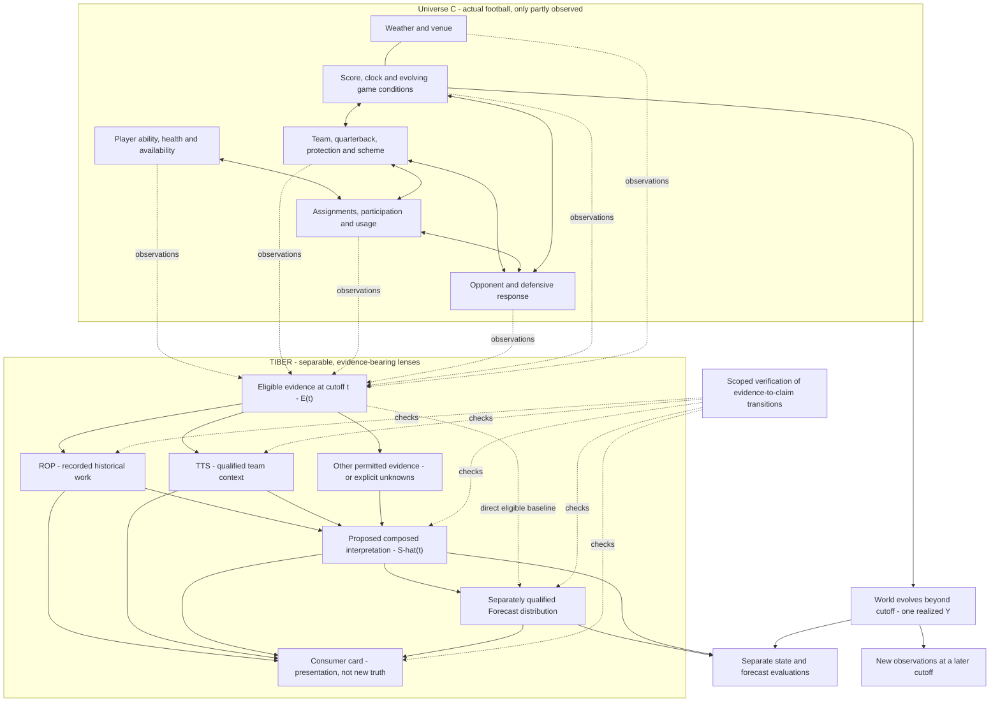

# Historical format copy — body-synthesis-2026-10-07

Prepared 2026-10-31T19:30:49.229705Z from [body-synthesis-2026-10-07](https://github.com/Prometheus-Frameworks/TIBER-Research/issues/29). No fresh football research, empirical re-evaluation or independent review was performed. Original source and all its stated limits remain authoritative for this historical edition. No future task or instruction quoted below is activated by this copy.

Source created: `None`; source updated: `2026-10-24T00:20:25Z`; captured: `2026-10-31T19:25:33.821Z`. [Exact captured source](retained/body-synthesis-2026-10-07.md), SHA-256 `a8f03d30227f3e410309241544ad1d80097f75bb67865d5396b464eca47a42ac`. These clocks do not authenticate original-publication bytes or external source availability.

This is a separately dated update/linked edition, not a rewrite of the original issue. See the [edition index](README.md) for earlier versions; do not merge their cutoffs.

## 1. Summary

### Edition-specific source orientation

The following exact passage is from this edition; quoted future actions remain proposals, not this task’s instructions.

> **Date:** October 7, 2026. **Disposition:** research/design proposal; not implemented, independently reviewed, or adopted as a production contract.

<!-- source-block 1; retrospective organizational mapping, not an original question ID -->
### Architecture synthesis v0

**Date:** October 7, 2026. **Disposition:** research/design proposal; not implemented, independently reviewed, or adopted as a production contract.

**Publication scope:** Joe asked to preserve this conversation on GitHub. This agent-authored synthesis extends the existing #29 rather than opening a competing Universe C issue or repository. Publication of this text is not an execution grant, authenticated operator receipt, empirical result, source admission, or model promotion.

<!-- source-block 7; retrospective organizational mapping, not an original question ID -->
### F. Typed claims: no silent changes of epistemic status

The following is proposed vocabulary for a reconciliation inventory, not a replacement schema:

| Claim kind | Example | Boundary |
|---|---|---|
| Observed/recorded | A source records nine credited targets in a specified game | Provenance-bearing observation, not infallible reality |
| Reported | A named source reports an availability condition | Preserve attribution and publication/availability clocks |
| Derived | A share computed using a specified numerator and compatible denominator | Deterministic result, not inferred role security |
| Inferred state | A model estimates a more persistent receiving role | Retain model, assumptions, uncertainty and limitations |
| Forecast | A distribution for next-game targets or fantasy production | Separate future horizon, scoring definition and evaluation |
| Outcome | Realized targets or fantasy points after the game | Later evidence, not knowledge available before that game |
| Scenario / thesis | A conditional absence scenario or an operator hypothesis | Do not promote a hypothetical condition into an observed fact |

Unknown, unavailable, stale and conflicting information remain explicit statuses. They are not zeros, observed absences, or precise probability estimates.

Reject silent casts such as inferred-to-observed, retrospective-to-as-known-then, or a schema-pass-to-publication-authorized transition. **Past outcomes may legitimately become evidence for later forecasts** once the relevant cutoff and purpose rules are satisfied. The prohibition is backward leakage, not learning from history.

A proposed claim receipt should reuse existing fields for: subject and identity bindings; season/phase/game/window; claim kind and units; numerator/denominator where relevant; exact input/version references; event, publication, availability, retrieval and cutoff clocks; transformations/model/training cutoff; purpose and rights evidence references; source overlap; missingness; uncertainty; and review/authorization references. Missing required witnesses withhold the affected claim; they do not authorize fabricated substitutes.

## 2. Question and scope

Universe C asks whether evidence-bounded state representations can improve justified beliefs about plausible outcomes without claiming certainty or direct access to latent football truth. This is conceptual research/design, not a measured NFL experiment.

<!-- source-block 4; retrospective organizational mapping, not an original question ID -->
### C. Compression is question-specific, not a universal football score

Joe's central observation is preserved here: **ROP and TTS compress different fronts of the sport.** That is a useful architectural interpretation, not proof that either summary retains all relevant information.

- **ROP:** preserve the meaning of recorded work in its historical window. `WeeklyRoleStateV1` does not silently become expected future workload, ability, or role security.
- **TTS / Teamstate:** preserve the team-context fields actually supplied and qualified by the specific artifact. Do not assume the label “Teamstate” includes every desirable QB, protection, scheme, injury, or opponent field.
- **Persistent/inferred player state:** a separate research candidate under #27 and Forecast's existing program, not a redefinition of ROP.
- **Composed state:** retain component identity, evidence lineage, scope and missingness; not one opaque “football truth” number.
- **Player State Card:** a presentation of qualified records. A change of layout, league selector, or consumer surface must not change the underlying football claim. League scoring and roster utility are separate, explicitly parameterized views.

A candidate research notation is:

`Z_i(t) = g_i(eligible evidence, window, purpose, version)`

`Ŝ_t = compose(Z_ROP, Z_TTS, other qualified inputs, explicit unknowns)`

These are proposals, not newly registered schemas. A deterministic summary cannot create new evidence absent from its inputs. Learned components must also disclose training data/prior lineage; an agent's unstated knowledge cannot quietly expand the evidence set.

For each compression, a future contract should say what question it serves, what it preserves, what it omits, its population and clock boundaries, and which downstream claims it cannot support. Whether information discarded by a compression matters must be tested against suitable baselines; do not call a summary statistically sufficient without establishing that property.

Overlapping lenses are not independent witnesses. If ROP and TTS share a source revision or denominator, composition must preserve that shared ancestry rather than count the same fact twice. Likewise, role, opportunity and efficiency are not automatically independent factors whose averages can simply be multiplied.

## 3. Baseline and alternatives

Contrast a bounded state/representation with realized outcomes and with a model’s forecast distribution. In the later synthesis, richer compression must compete with simple representations; a passing verifier establishes only its enforced conformance rules, not empirical truth, authority or calibration. UGC is motivation, not evidence.

<!-- source-block 10; retrospective organizational mapping, not an original question ID -->
### I. Reconcile with existing owners; do not create parallel architecture

| Existing record/layer | Relationship to this synthesis |
|---|---|
| **Research #29** | Home for the Universe C framing and proposed evidence/state/outcome/verification distinctions |
| **Research #27 and its October 4 audit** | Existing investigation of persistent estimators, candidate component states, baselines and evaluation; no second persistent-state program here |
| **Forecast #190** | Existing point-in-time historical-evidence qualification and preparation gate; this synthesis does not authorize the experiment |
| **Data** | Evidence, source revisions, identity, custody/availability witnesses and consumer eligibility under existing contracts |
| **ROP** | Recorded historical work; no predictive-semantic change |
| **TTS / Teamstate** | Optional, purpose-qualified team context; no implied full feature coverage or source independence |
| **Forecast** | Existing home for predictive inference/distributions under its own scope; no new model or current behavior change |
| **Research custody** | Preserve exact research inputs, candidates, reviews and seals; a public issue is not a sealed Research run |
| **Harness** | Separate conformance/evaluation layer; not a live research executor, production dependency or promoter |
| **Fantasy / existing Player State Card work** | Render eligible records without changing their meaning or treating a UI as ground truth |
| **Ops / operator** | Existing activation, amendment, publication, promotion and revocation authority; issue prose grants none of these implicitly |

The October 4 audit already makes several of these boundaries explicit: ROP is observational, shared Data lineage is not independent corroboration, inferred checkpoints belong within Forecast's existing program, and direct Data inputs can be appropriate. This synthesis sharpens the **separate state-versus-outcome evaluation contract** rather than replacing that audit.

References: [#27](https://github.com/Prometheus-Frameworks/TIBER-Research/issues/27) · [October 4 audit](https://github.com/Prometheus-Frameworks/TIBER-Research/issues/27#issuecomment-5980269904) · [Forecast #190](https://github.com/Prometheus-Frameworks/TIBER-Forecast/issues/190) · [ROP observed-state contract cited by that audit](https://github.com/Prometheus-Frameworks/Role-and-opportunity-model/blob/eab07cbfc17a841804991194ac162609224bf744/docs/contracts/weekly-role-state-v1.md)

The audit is an attributed historical source, not a fresh certification of every linked repository, deployment or player artifact. The README and issue records were read for this publication; no tests, producers or empirical experiments were rerun.

## 4. Evidence by question

### Question-level source crosswalk

`R-map-` IDs are retrospective navigation mappings, not original selections. Original IDs are used only when the exact token appears in this edition. Each locator names the retained source line where its specific topic begins; read the full indicated source section/table row, including its limits.

#### R-map-compression — Bounded compression

- **Source and specific locator:** [### C. Compression](retained/body-synthesis-2026-10-07.md?plain=1#L98), source line 98; [original record](https://github.com/Prometheus-Frameworks/TIBER-Research/issues/29); exact capture SHA-256 `a8f03d30227f3e410309241544ad1d80097f75bb67865d5396b464eca47a42ac`.
- **Type:** conceptual design.
- **Assessment / contrary evidence / limit:** Not statistical sufficiency or universal football score.
- **Window and operands:** retain the exact population, units and exclusions in that source section; no source or edition pooling. Unspecified operands remain unknown.
- **Clocks:** source created `None`, updated `2026-10-24T00:20:25Z`, retrieved `2026-10-31T19:25:33.821Z`. These are record clocks, not original evidence availability; any explicit evidence cutoff in the source controls. Unspecified evidence clocks stay unknown.
- **Next action:** preserve this status; original investigator must qualify any missing witness before new research or reuse. No follow-up is activated by formatting.

#### R-map-verifier — Bounded verifier

- **Source and specific locator:** [### E.](retained/body-synthesis-2026-10-07.md?plain=1#L139), source line 139; [original record](https://github.com/Prometheus-Frameworks/TIBER-Research/issues/29); exact capture SHA-256 `a8f03d30227f3e410309241544ad1d80097f75bb67865d5396b464eca47a42ac`.
- **Type:** conceptual design.
- **Assessment / contrary evidence / limit:** Conformance not truth/authority.
- **Window and operands:** retain the exact population, units and exclusions in that source section; no source or edition pooling. Unspecified operands remain unknown.
- **Clocks:** source created `None`, updated `2026-10-24T00:20:25Z`, retrieved `2026-10-31T19:25:33.821Z`. These are record clocks, not original evidence availability; any explicit evidence cutoff in the source controls. Unspecified evidence clocks stay unknown.
- **Next action:** preserve this status; original investigator must qualify any missing witness before new research or reuse. No follow-up is activated by formatting.

#### R-map-evaluation — Three evaluation types

- **Source and specific locator:** [### H.](retained/body-synthesis-2026-10-07.md?plain=1#L217), source line 217; [original record](https://github.com/Prometheus-Frameworks/TIBER-Research/issues/29); exact capture SHA-256 `a8f03d30227f3e410309241544ad1d80097f75bb67865d5396b464eca47a42ac`.
- **Type:** evaluation design.
- **Assessment / contrary evidence / limit:** No empirical execution or direct latent truth witness.
- **Window and operands:** retain the exact population, units and exclusions in that source section; no source or edition pooling. Unspecified operands remain unknown.
- **Clocks:** source created `None`, updated `2026-10-24T00:20:25Z`, retrieved `2026-10-31T19:25:33.821Z`. These are record clocks, not original evidence availability; any explicit evidence cutoff in the source controls. Unspecified evidence clocks stay unknown.
- **Next action:** preserve this status; original investigator must qualify any missing witness before new research or reuse. No follow-up is activated by formatting.

<!-- source-block 2; retrospective organizational mapping, not an original question ID -->
### A. The central distinction: reality, evidence, representation

> **Universe C is the football world. TIBER builds a map of it, not the world itself.**

Use the existing notation rather than introduce a competing state ontology:

| Concept | Meaning | What it is not |
|---|---|---|
| Universe C / `S_t` | The actual football situation and its evolving relationships at time t | A TIBER database, score, card, or complete list of observable variables |
| `E_t` | The evidence available and eligible for the stated question at cutoff t | Complete access to reality or automatic proof that a source is correct |
| `Ŝ_t` | A bounded, purpose-specific representation constructed from that evidence | Ground truth, a guarantee of next-week opportunity, or a complete reconstruction of football |
| `P_M(Y given E_t)` | A model's distribution over future outcomes, possibly using explicit state summaries | The true distribution established merely because a model emitted it |
| `Y` | One realized outcome or game trajectory | A complete measurement of the pregame state or its distribution |

The working research hypothesis is that useful, inspectable state summaries can preserve relevant structure without erasing uncertainty. The existence of a world outside the model is a conceptual boundary; the usefulness of particular summaries and models must be tested. This is not a claim to have proved physical indeterminism or identified football's irreducible-error floor.

The original phrase “football is not random” should be read as **“football is not structureless.”** Structure and uncertainty can coexist. Likewise, Universe A/B are conversational contrasts, not audited descriptions of the fantasy industry.

<!-- source-block 3; retrospective organizational mapping, not an original question ID -->
### B. The picture: a web, observed through compressed lenses

The following is a conceptual relationship diagram, not a measured causal graph and not the current runtime topology. Relationships and optional future components require their own evidence and contracts.



**Reading the picture:** The web belongs to reality. The lenses belong to TIBER. Dotted verification edges check scoped records; they do not let the verifier inspect reality directly. Arrows from a state or forecast into a card are conditional on qualification, not a statement that those outputs already exist.

“Everything needs everything” becomes: **relationships matter, but not every component must depend on every other component.** ROP and TTS need not be mandatory serial gates. The October 4 #27 audit explicitly permits exact, qualified Data observations to feed Forecast directly.

Football can contain feedback over time. Artifact provenance should not justify itself through circular references: represent successive immutable checkpoints and explicit time-indexed dependencies rather than letting a current claim cite itself as evidence.

<!-- source-block 5; retrospective organizational mapping, not an original question ID -->
### D. The targets-only example: preserve the insight, tighten the analogy

Consider the explicitly simple toy model:

`next-week fantasy-point estimate = a + b * last-week targets`

A few close predictions do not establish that it understands the process generating targets or their conversion into points. Identical inputs produce identical predictions in this toy model even when two players' unobserved situations differ.

The conversation's accurate-QB versus inaccurate-QB receivers are **hypothetical mechanism examples**, not source-qualified claims about named NFL players. The model may miss future target-volume changes, target quality, depth, defensive attention, or conversion variation. A miss alone does not identify which explanation was responsible; mechanism attribution needs evidence.

Two important qualifications:

1. **One input is not the same as low model complexity.** The stated linear toy is simple; a highly flexible function of one input need not be. Feature count, functional flexibility, data requirements and information quality are different quantities.
2. **The denominator in rational approximation is not a formal measure of football-model complexity.** The discussion of pi supplied an analogy about isolated impressive fits versus systematic behavior, not a theorem bounding fantasy predictability.

Candidate research question: **Does a richer, more inspectable representation improve held-out performance or interpretation enough to justify its added complexity?** More variables do not earn admission merely by sounding football-relevant. Strong predictive performance also does not, by itself, establish a causal explanation.

UGC and the mathematical discussion are inspiration only. No claim about the correctness or formalization status of any particular OpenAI mathematical result is a premise of this architecture.

<!-- source-block 6; retrospective organizational mapping, not an original question ID -->
### E. “Lean for football”: a bounded verifier, not a truth oracle

The transferable idea is to separate candidate generation from checking a precisely stated claim. Lean checks formal proofs in a specified logical environment; its axioms and dependencies matter. A football evidence checker is **not equivalent to a theorem prover** and cannot mechanically establish that a latent role interpretation corresponds to reality. [Lean reference manual](https://lean-lang.org/doc/reference/latest/Introduction/) · [Axioms and computation](https://lean-lang.org/theorem_proving_in_lean4/Axioms-and-Computation/)

A suitable proposed TIBER contract is:

> **Given these exact evidence records, declared assumptions, versioned transformations, cutoff and purpose, does this claim satisfy the rules the checker actually enforces?**

Conceptually:

```text
exact inputs + declared rule/model version + candidate claim + cutoff + purpose
    -> scoped checks
    -> conformance receipt + failures/unknowns + explicit limits
```

A passing receipt could establish arithmetic, schema conformance, identity/scope compatibility, evidence linkage, timestamp conditions, and reproducibility within its implemented scope. It cannot establish source honesty, legal entitlement merely from a declared rights field, reviewer competence, causal truth, model calibration, or guaranteed future performance.

**Keep four statuses distinct:** mechanical conformance, substantive review, empirical support, and operator/purpose authorization. Passing one does not imply the others. A recorded authorization claim is not automatically authenticated human authority.

This is a proposed contract view over existing machinery, **not a request to build a new Lean-like engine, new repository, or universal kernel**. Research already describes custody and claim-traceability checks; Harness already separates advisory model output from deterministic conformance checks. Their actual scopes and exclusions remain binding. [Research README](https://github.com/Prometheus-Frameworks/TIBER-Research/blob/main/README.md) · [Harness README](https://github.com/Prometheus-Frameworks/TIBER-Harness/blob/main/README.md)

<!-- source-block 8; retrospective organizational mapping, not an original question ID -->
### G. A checkable example and explicit negative cases

**All values below are synthetic teaching examples. No real-player artifact or producer run is asserted.**

Suppose a frozen packet records:

```text
player credited targets: 9
team credited targets: 36
same game, team scope, metric definition and source revision
compatible identity and denominator coverage
qualifying evidence for the intended cutoff and purpose
```

A compatible rule can derive `9 / 36 = 0.25` as a **historical credited-target share**. It cannot derive “HIGH future receiving opportunity” merely by relabeling that number. Routes, next-week targets and next-week fantasy points remain unestablished unless separately supported.

Candidate conformance cases for a later, separately authorized synthetic test packet:

| Case | Required behavior |
|---|---|
| Exact compatible inputs and correct arithmetic | Permit the narrowly scoped historical derivation only |
| Team attempts substituted for credited-target denominator without a permitted definition | Reject the unsupported denominator substitution |
| Numerator/denominator from different weeks, teams or incompatible revisions | Reject the join/scope mismatch |
| Routes missing while targets exist | Preserve routes as unavailable; do not manufacture participation |
| An inferred role relabeled as observed | Reject the type/status promotion |
| Data retrieved after a historical cutoff with no qualifying availability witness | Withhold point-in-time predictive use; do not backdate availability |
| Corrected historical view presented as the original known-at view | Reject the temporal claim; retain separately labeled retrospective scope where permitted |
| ROP and TTS reuse the same evidence ancestry | Preserve dependence; do not manufacture independent corroboration |
| Missing, inactive, bye and genuine zero collapsed into one value | Reject the unsupported equivalence |
| Point estimate displayed as a calibrated interval without support | Withhold the invented distributional claim |
| Matching realized score from a leakage-contaminated forecast | Reject the invalid derivation despite the numerical hit |
| A past outcome used at a genuinely later eligible cutoff | Allow the properly qualified historical input; never rewrite the earlier frozen record |
| Successful validation treated as permission to publish or change a roster | Reject the authority escalation |

These are **test-design requirements, not implemented or executed tests**. Policy versions, exact error codes and owners must be reconciled before any implementation.

<!-- source-block 9; retrospective organizational mapping, not an original question ID -->
### H. Three evaluations, not one green badge

**1. Derivation/conformance evaluation:** Were the inputs, arithmetic, identities, types, purposes and clocks handled according to the explicit rules? This is where deterministic validators can supply bounded guarantees.

**2. State-claim evaluation:** Did a predeclared interpretation explain or anticipate relevant football structure better than alternatives? A latent state is not directly visible just because Sunday's box score exists. Use independently specified witnesses where available, competing interpretations, and predeclared observable implications. Avoid evaluating a state against a label constructed from the very same inputs and calling that independent validation. Some states will be observationally hard to distinguish; report that limitation.

**3. Outcome-distribution evaluation:** Did frozen probabilistic forecasts perform usefully across an appropriate held-out population? Candidate methods remain those already proposed in #27/#29: proper scoring, calibration, interval coverage with width, sample counts and dependence-aware uncertainty. A single correct score neither proves calibration nor validates all components.

Maintain separate state-estimation uncertainty, future-outcome variability, and data/model limitations. Do not invent numerical confidence when only qualitative uncertainty is supported.

A valid derivation can feed a poor model. A well-supported pregame role can coexist with an unexpectedly poor outcome. A lucky outcome cannot rescue an invalid derivation. Conversely, repeated disagreement with predeclared implications must be allowed to challenge the state model; “Universe C is uncertain” cannot become an unfalsifiable excuse.

<!-- source-block 11; retrospective organizational mapping, not an original question ID -->
### J. Durable research summaries, not just durable chats

A future human-readable summary should be a view over existing Research records, not a second ledger or an invented reconstruction of an agent's private reasoning. It should preserve:

```text
Question and intended use
Evidence available at the cutoff, with exact references
Hypothesis and competing explanations
Assumptions and known limitations
Approaches considered and documented failure reasons
Method / experiment / derivation references
Result and uncertainty
What this establishes
What this does not establish
Mechanical-check, independent-review and empirical-support status
Unresolved gaps and their owning layer
Publication / promotion / operator-authorization status
Version, predecessor and correction or supersession links
```

Failed approaches are useful when their evidence and failure conditions were actually recorded. Do not invent a research history to make a final result look more rigorous. Corrections should create explicit successor records under existing custody rules rather than silently rewriting frozen evidence or forecasts.

## 5. Interpretation and assessment

The synthesis is a documented proposal, not implemented, independently reviewed or adopted. Its diagram and verifier are conceptual; conformance, empirical support and authority remain separate.

## 6. Unknowns and revision triggers

Unstated evidence cutoffs, original availability clocks, independent review or field definitions remain unknown. Source-internal limits remain intact; request missing metadata from the original owner before reuse.

## 7. Next checkpoint and closeout

<!-- source-block 12; retrospective organizational mapping, not an original question ID -->
### K. Smallest proposed next step and stop boundary

**Proposed only:** one read-only **Universe C claim-and-transition crosswalk** under this existing issue, reconciled with #27 and Forecast #190. No execution is dispatched by this paragraph.

That packet should inventory a small set of existing artifact types and record, for each: owner; actual claim kind; exact contract; cutoff/purpose; inputs and shared ancestry; what existing validators check; what requires substantive review; what requires empirical evaluation; unsupported claims; and the smallest missing positive/negative test specification.

Start with an existing historical ROP record, an existing qualified TTS record, their existing descriptive composition, and the already proposed inferred-checkpoint/card interfaces. Missing or inaccessible examples must remain explicit gaps. Do not acquire replacement football data or generate new player values to complete the matrix. Any later formalization, schema patch, source qualification or experiment needs its own bounded proposal and operator decision.

**Documentation acceptance checklist:**

- [x] Distinguish Universe C, eligible evidence, bounded state, modeled distribution and realized outcome.
- [x] Preserve ROP/TTS semantics and optional composition rather than require an everything-depends-on-everything chain.
- [x] Include a readable relationship diagram and explain its non-causal, non-runtime status.
- [x] Define the verifier's limits and keep conformance, review, empirical support and authority separate.
- [x] Record typed-claim, temporal-leakage and shared-lineage failure examples.
- [x] Separate state and outcome evaluations without claiming direct access to latent truth.
- [x] Reuse #27/#190 and existing custody/Harness/consumer boundaries.
- [x] Preserve a bounded, non-dispatched next-step proposal.
- [ ] Independent review of this synthesis.
- [ ] Operator adoption of any resulting contract changes; not requested or inferred here.

**Terminal boundary:** documentation recorded in #29 only. No production code, new schema, source acquisition/admission, real-player output, producer run, predictive experiment, model change, schedule, merge, deployment, spending, or fantasy action is authorized by this synthesis. It neither resolves another issue's blockers nor certifies an existing artifact.

> **Universe C is the world. TIBER's states are bounded maps. Verification checks the construction and permitted use of those maps; empirical evaluation tests how useful they are. The operator retains the decision.**

## 8. Sources, review and amendment history

Original source/version and retained bytes are linked above. Formatting is separate from research completion, acceptance and merge state.

### Format preparation fidelity

All source text blocks are retained and mapped once; source headings may be demoted for the shared outer shape. Relative repository links are resolved against the exact source commit. Existing question IDs, calculations, qualifiers and instructions are not rewritten. `source-map.json` gives per-block hashes and placements. Unknown header cutoff is deliberately not filled from retrieval or issue-update time. Independent copy review is pending; no downstream permission is granted.
